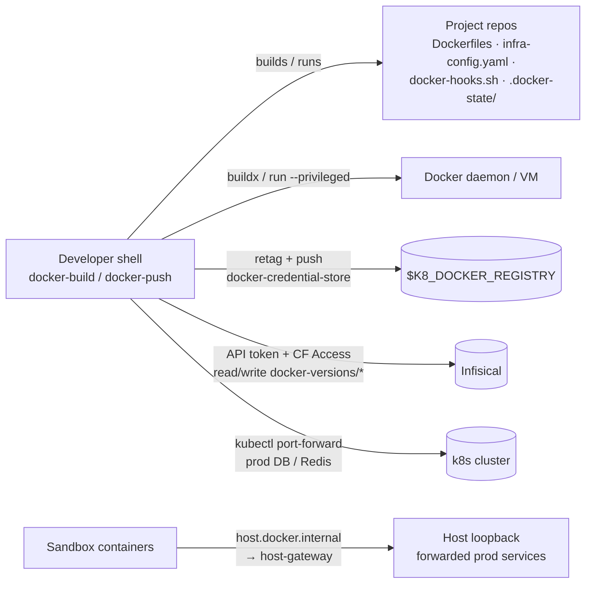

# Threat Model

<!-- Scope note: this model covers the docker-tools package only (bin/ scripts,
     Makefile, completions). It is grounded in PROJ-ARCH.md / PROJ-LAYOUT.md and
     verified against the source at each register entry. -->

## Overview

docker-tools is single-user developer-workstation tooling: it builds and pushes
Docker images, resolves patch versions from Infisical, and runs sandbox stacks
against port-forwarded production services. It holds no server-side component
and no database — its crown jewels are the credentials it *borrows*: registry
push credentials (`docker login $K8_DOCKER_REGISTRY`), the Infisical API token
(write authority over shared `docker-versions/*` keys, also used by CI), and
the kubeconfig that can reach production services. Compromise of this toolchain
therefore means compromise of image supply, version state, and a production
data path.

## Trust Boundaries

1. **Project repos being built ↔ tooling shell** — repo content (Dockerfiles,
   `infra-config.yaml`, `docker-hooks.sh`, `.docker-state/`) is consumed by the
   scripts, partially as *executed* shell code.
2. **Workstation ↔ Docker daemon** — builds plus one deliberately privileged
   container (`docker-qemu11`).
3. **Workstation ↔ container registry** — push authority via the standard
   docker credential store; this package stores no credentials itself.
4. **Workstation ↔ Infisical** — version keys read/written over TLS through
   Cloudflare Access; the token is handed to child processes via environment.
5. **Workstation ↔ k8s API** — `kubectl port-forward` tunnels production
   DB/Redis to host loopback.
6. **Sandbox containers ↔ host network** — generated compose override adds
   `host.docker.internal:host-gateway`, bridging sandbox containers to the
   loopback-forwarded production services.

→ *Surface detail: [PROJ-ARCH.md](PROJ-ARCH.md) · data artifacts: [PROJ-SCHEMA.md](PROJ-SCHEMA.md)*

## Vulnerability Register

| ID | Severity | STRIDE | Component | Status |
|----|----------|--------|-----------|--------|
| T-001 | Medium | Elevation of privilege | `bin/docker-build` auto-sources `${INFRA_ROOT}/docker-hooks.sh` when present (bin/docker-build:68) — building any repo executes its code in the user's shell | Open — by-design extension point; mitigate by policy: only build trusted repos |
| T-002 | Medium | Tampering → Elevation of privilege | `.docker-state/{last,shadow,builds,pushes}` are bash-sourced state files; a planted/tampered file in a project repo is executed by push/build paths | Partial — local single-user workstation, files not validated on read |
| T-003 | High | Information disclosure | `docker-sandbox` port-forwards production DB/Redis to loopback, then bridges sandbox containers to them via `host.docker.internal:host-gateway` (bin/docker-sandbox:393-432) — any container in the sandbox stack can reach production data stores | Partial — forwards bind loopback only; override limited to named hosts/ports; never point a sandbox stack at untrusted images |
| T-004 | Medium | Spoofing / Tampering | Infisical `API_TOKEN` (+ CF Access client id/secret) live in the environment and are exported from `docker-build` preflight to `docker-push` children; any child process (hooks, build args) can read them | Partial — TLS + CF Access front door; token scope is version keys, but write authority is shared with CI |
| T-005 | Low | Tampering (supply chain) | `docker-qemu11` runs a `--privileged` container from mutable tag `debian:unstable-slim` (overridable via `DOCKER_QEMU11_INSTALLER_IMAGE`) | Open — pin the installer image digest for repeatable trust |
| T-006 | Medium | Tampering | `docker-push --release` rewrites the helm values image tag in the app repo — an unexpected local git mutation on a shared checkout | Mitigated — explicit opt-in flag; release tags are otherwise CI-owned (`bump-chart`) |
| T-007 | Low | Information disclosure | Failure diagnostics surface HTTP response bodies (Infisical auth/project lookup, m2 hardening) and build logs land in `.tmp/docker-build-logs/`; version keys are low-sensitivity but response bodies are echoed unredacted | Partial — scoped to `docker-versions/*` endpoints; no registry or app secrets stored by this package |

## Mitigation Coverage

1 mitigated · 4 partial · 2 open. Open items T-001/T-005 are accepted dev-lane
trade-offs (extension point, mutable installer tag); T-005 can be closed by
pinning `DOCKER_QEMU11_INSTALLER_IMAGE`. No tickets yet — this is the first
registered model (2026-10-26).

→ *Control details: [PROJ-SCHEMA.md](PROJ-SCHEMA.md) §2 (env/secret inputs), [PROJ-ARCH.md](PROJ-ARCH.md) (configuration flow)*

## Residual Risk

- **Repo content is executed by design** (T-001, T-002): the workstation trust
  model assumes projects under `INFRA_ROOT` are first-party. Building external
  or untrusted repos with these tools is out of model.
- **Sandbox-to-prod bridge** (T-003): accepted for dev velocity; the tool
  deliberately never fetches or ships app secrets — the app's own env/init must
  have run, and production writes from a sandbox remain possible by design.
- **Version-key write authority** (T-004): concurrent builders and CI share
  monotonic versions through Infisical; a leaked workstation token can advance
  or reset version counters (visible, recoverable — no image or data impact).

## Maintenance

Update this model when: a new flag changes where credentials or state files
flow, the sandbox override shape changes, the registry/Infisical auth path
changes, or `docker-hooks.sh` gains validation. Keep `T-###` IDs stable;
append, never renumber.
